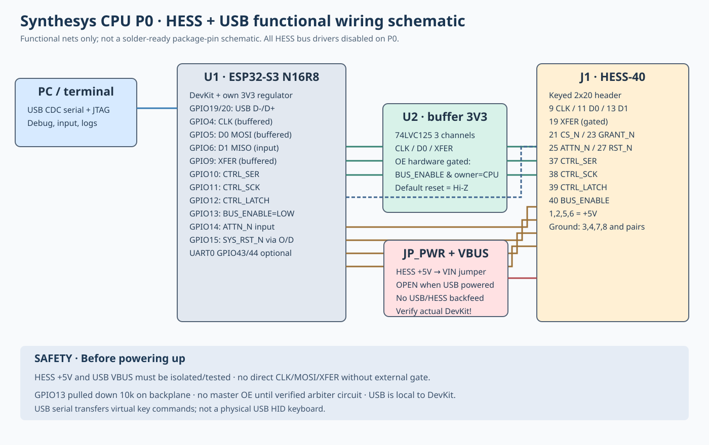

> **Актуальное решение:** питание CPU идёт от [отдельно запитанной backplane через HESS 5 В](09-backplane-powered-p0.md). USB-питание и разомкнутый JP_PWR в дальнейших разделах относятся к **отвергнутому варианту P0**. Первичный USB-Serial/JTAG монитор остаётся альтернативной прошивкой; для новой схемы подготовлен вариант UART0 с отдельным USB–UART (VCC не подключать).

# CPU P0 — принципиальная схема подключения и USB-монитор

**Состояние:** предварительная wiring-спецификация и блок-схема для паяной перфоплаты. **Не готовый производственный KiCad schematic**: точные разъёмы devkit, polarity USB VBUS, GPIO availability и схема backplane gates требуют проверки на той самой плате, которая будет куплена/использована.

> **Точные физические места контактных площадок J1/J3 и номера ножек SN74AHC125N:** [монтажная таблица](07-devkitc1-dip14-wiring.md). Для другой ревизии DevKitC-1 проверить разводку и маркировку GPIO.

> **Монтажное исправление:** [соединения U1/U2/JH1 без двусмысленных стрелок](08-cpu-p0-connections-clarified.md). В прежних рисунках пересечения проводников и названия J1 были недостаточно ясными. Не паять по ранним иллюстрациям.

## Состав

- U1 — **ESP32-S3 N16R8 DevKit** с 16 МБ SPI Flash и 8 МБ Octal PSRAM, установленная в ответные гребёнки перфоплаты.
- J1 — **HESS-40** 2×20, shrouded keyed IDC/header на **одном торце**, к нему сходятся все сигналы и системное питание.
- J2 — **USB Device/Serial-JTAG** на **самой ESP32-S3 DevKit**, подключение к ПК для прошивки, двустороннего терминала и JTAG. **USB D+/D− НЕ вести через HESS/МГТФ**.
- U2 — трёхканальный/четырёхканальный 3,3 В buffer с Hi-Z, для перфоплаты **SN74AHC125N (PDIP-14)**: CPU CLK, D0, XFER → HESS. `/OE` **только от hardware CPU_GRANT gate**, а не напрямую GPIO ESP.
- R_RESET — опциональная схема open-drain RST_N, использующая отдельный транзистор/буфер: при её отсутствии pin27 не подключать на P0.
- JP_PWR — **физический разрыв HESS +5 V → DevKit +5 V** для режима питания от USB (P0). Подключать одновременно USB+HESS power без отдельной проверенной схемы запрещено.
- Выход на pins37–40 к serial latch контроллера backplane; его микросхемы находятся **на backplane, не CPU**, так чтобы все периферийные карты не усложнялись CPU-логикой.
- Точки диагностики: `TP_5V`, `TP_3V3`, `TP_GND`, `TP_CLK`, `TP_D0`, `TP_D1`, `TP_XFER`, `TP_GRANT`, `TP_ATTN`, `TP_BUS_EN`.

## Функциональная схема

**Схема показывает связи сигналов, не выводы платы в физическом пространстве.** На неиспытанном стенде `/OE` CPU-драйверов держать деактивированным, внешние выходы CLK/D0/XFER отсутствуют. `/OE` должно зависеть от hardware backplane gate CPU=OWNER0, BUS_ENABLE и reset.

## Net mapping CPU (ESP32 GPIO → J1 HESS-40)

| U1 GPIO | Режим | Цепь | J1 pin |
|---:|---|---|---:|
| 4 | SPI master CLK (buffered) | CLK | 9 |
| 5 | SPI master MOSI (buffered) | D0 | 11 |
| 6 | SPI master MISO input | D1 | 13 |
| 7 | **input/Hi-Z** (QPI reserve) | D2 | 15* |
| 8 | **input/Hi-Z** (QPI reserve) | D3 | 17* |
| 9 | transaction pulse, **buffered** | XFER_OUT_N | 19 |
| 16 | selected as slave? **future/NC in CPU P0** | SLOT_CS_N | 21* |
| 17 | CPU grant sense (optional monitor) | SLOT_GRANT_N | 23* |
| 14 | digital input (external pull-up backplane) | ATTN_N | 25 |
| 15 | CPU controls reset **through open-drain transistor** (optional) | SYS_RST_N | 27* |
| — | NC | RESERVED_READY | 29 |
| — | NC (CPU not a peripheral slot) | SLOT_ID0–2 | 31,33,35 |
| 10 | serial DATA → backplane latch | CTRL_SER | 37 |
| 11 | serial CLOCK → backplane latch | CTRL_SCK | 38 |
| 12 | serial STROBE → backplane latch | CTRL_LATCH | 39 |
| 13 | active-high, pulldown 10 kΩ at backplane | BUS_ENABLE | 40 |
| 19 | native USB D- via devkit USB only | USB_D- | J2 local |
| 20 | native USB D+ via devkit USB only | USB_D+ | J2 local |
| 43/44 | UART0 optional fallback, **3,3 V levels** | UART | local test pad |

`* NC/isolated until implemented and tested`. GPIO16/17/15 status lines not physically connected on P0 unless the backplane variant explicitly implements them. **Do not hardwire GPIO4/5/9 directly to shared bus in multi-master mode**, even if this is convenient on a two-board bench.

**Разделение контактов:** J1 pin1/2/5/6 +5 V; 3/4/7/8 + оставшиеся ground-пины — GND. Логические цепи **не выше 3,3 В**. У1 3V3 получает питание от стабилизатора devkit, **не** с J1. Контакты 37–40 не подключаются к периферийным платам.

## Уточнение USB

На ESP32-S3 аппаратный **USB Serial/JTAG CDC-ACM** работает как USB serial device при GPIO19 (D−), GPIO20 (D+). Это **не USB HID клавиатура на ПК**: клавиатуру ПК эмулируем *командами терминала* (например `key left`), которые потом превратятся в события ввода ОС. ESP-IDF USB Serial/JTAG поддерживает также flashing и JTAG:

https://docs.espressif.com/projects/esp-idf/en/stable/esp32s3/api-guides/usb-serial-jtag-console.html

Штатный devkit с USB разъёмом уже имеет необходимую разводку; не дублировать D+/D- проводами до второго USB разъёма. У USB-D+/- должна быть нормальная дифференциальная трассировка, GPIO 19/20 исключить из HESS.

## Отправная точка прошивки

`firmware/cpu-monitor/` — ESP-IDF USB monitor `P0`, который умеет `help`, `version`, `status`, `mem`, `hess`, `modules`, `key`, `input`, `boot`. До готовности межслотовой аппаратной схемы не включает HESS buffers. Команды к Storage честно сообщают «not implemented»; **никакого выдуманного чтения SD**.

### Как тестировать CPU без остальных модулей

1. Отсоединить питание HESS/все внешние модули. JP_PWR open.
2. Подключить DevKit к ПК именно в порт USB Serial/JTAG (если на плате два USB, выбрать порт с GPIO19/20).
3. `idf.py set-target esp32s3 && idf.py build && idf.py -p /dev/ttyACM0 flash`.
4. `idf.py -p /dev/ttyACM0 monitor` или `picocom -b 115200 /dev/ttyACM0`; `help`, `status`, `key up`, `input`.
5. Пробовать GPIO/буферы и включать `BUS_ENABLE` **только после отдельного электрического теста backplane**, НЕ в первоначальной прошивке P0.

### Требования для пайки

Составить фото и маркировку DevKit, проверить pinout USB, наличие PSRAM, polarity +5 V, GPIO внешних функций. Сам подключаемый интерфейс HESS должен быть однозначно промаркирован pin1/key и прозвонен на КЗ. После выбранной схемы backplane OE появится настоящая KiCad схема и файл монтажных соединений с пронумерованными выводами конкретных корпусов, а не только эта функциональная схема.

## Этапы

- **P0**: CPU standalone USB monitor, безопасная HESS без включённого OE.
- **P1**: CPU + Storage, чтение блоков, FAT32 и поиск OS loader.
- **P2**: USB-терминал для маленькой ОС и файлового коммандера, работающей на CPU, но загруженной с Storage.
- **P3**: Video — локальный текстовый вывод и полноценный экранный файловый менеджер.
- **P4**: Input — реальная PS/2 или USB клавиатура, терминал ПК остаётся debug-каналом.
- **P5**: Sound — локальный синтез, full five-module performance acceptance.

[Подробнее о последовательности](06-boot-stages.md).